<div align="center">

# 🛰️ CTO Watch — Engineering Leadership Hub
### *CTO-Copilot · Your AI Command Center for Team Velocity, PR Intelligence & Executive Insight*

[](https://www.python.org/)
[](https://fastapi.tiangolo.com/)
[](./docker-compose.yml)
[](./alembic/versions/)
[](./docker-compose.yml)
[](./app/services/chat_service.py)
[](./app/services/llm_service.py)
[](./app/services/llm_service.py)
[](./app/services/voice_service.py)
[](./app/services/celery_app.py)

**One dashboard to rule all PRs. AI summaries in seconds. Impact-ranked engineers. A chatbot that *queries your live database*. A voice agent you can talk to. Daily PDF reports on your desk at 08:00. All behind a password + Google Authenticator gate.**

[🚀 Quick Start](#-quick-start--run-in-60-seconds) · [✨ Features](#-feature-atlas--every-screen-dissected) · [📸 Showcase](#-visual-showcase--live-screenshots) · [🏗️ Architecture](#️-system-architecture) · [🤖 AI Stack](#-ai-brain--bedrock--groq--jev) · [📡 API](#-api-reference) · [⚙️ Config](#️-configuration--env-cheat-sheet)

</div>

---

## 🧭 Product Tour

| Screen | Overview |
|---|---|
| 🏠 **Home — Team Velocity & Pulse** | Live SLA Health card (% within SLA + bar) + 7-day Opened-vs-Merged SVG chart |
| 🔀 **PR Requests Directory** | Auto-populated PR table: author · date · executive AI summary · state · impact score · details link + `All/Open/Merged/Closed` filters |
| ⚠️ **Overdue / SLA Alerts** | Every open PR older than `PR_STALE_THRESHOLD_DAYS` (default **5**) with overdue-duration counter |
| 🏆 **Engineer Impact Dashboard** | Leaderboard ranked by **impact, not commit count** — 8 time windows (Today → 1 Year), avg/total impact, tier badges |
| 💬 **CTO AI Copilot (Chat)** | LangGraph agent with live read-only MySQL access, sessions sidebar, bilingual AR/EN, query-rewrite for follow-ups |
| 📄 **Daily CTO Reports** | One PDF every morning at **08:00 Africa/Cairo** — Preview inline / Download attachment |
| 🎙️ **Voice Copilot** | Push-to-talk Deepgram agent: glowing orb · live transcript · real-time `🔍 Querying MySQL:` badge |
| 🔐 **Access Gate** | Shared password → QR enroll in Google Authenticator → 6-digit TOTP → optional *Remember this device* |
| 📧 **Email Triage** | Unread inbox, auto-summarized — From · Subject · Summary · urgency score + tier chip |
| 📢 **Slack Bot Integration** | SLA breach Block Kit alerts + automated morning PDF report uploads directly to Slack |
| 🧪 **Eval Lab** | One-click hallucination torture suite — judge ON/OFF runs compared side by side in MLflow |

---

## 📸 Visual Showcase — Live Screenshots

*Real captures from the running app — no mockups. Walk the product top to bottom, exactly as a CTO would on day one.*

### 🔐 Access Gate — Password + TOTP

The whole app sits behind one locked door — pages *and* APIs. Shared password first, then a 6-digit Google Authenticator code (QR enroll on first setup, *Remember this device* for 7 days).

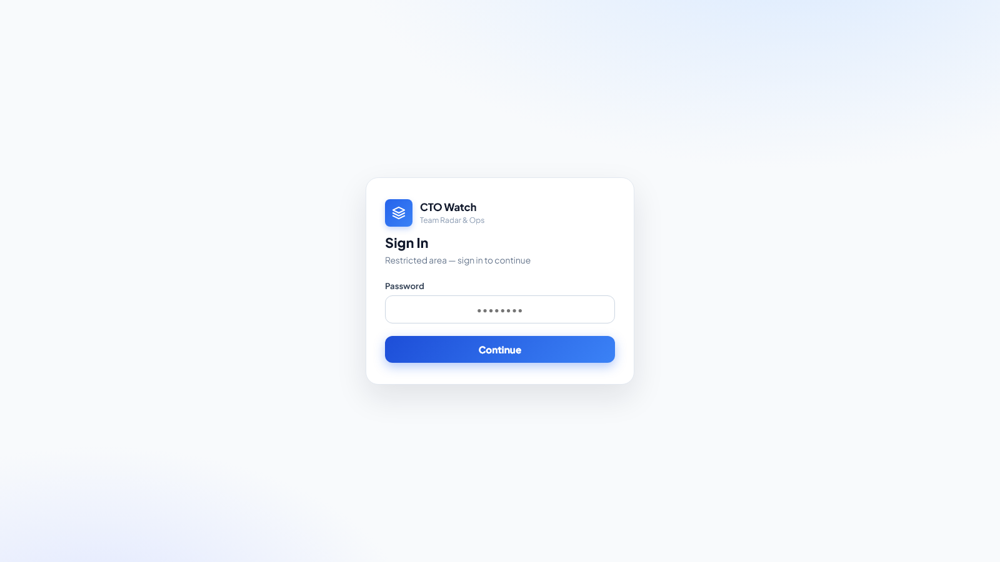


### 🏠 Home — Team Velocity & Engineering Pulse

The 10-second executive glance: live SLA Health (100% here — 1 within SLA, 0 breached) plus the 7-day Opened-vs-Merged chart, computed from real PRs on every visit.

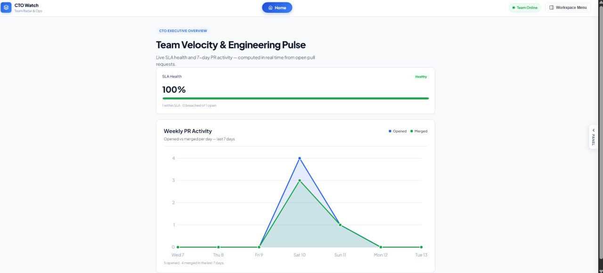

### 🔀 PR Requests — Automated PR Intelligence

Every GitHub PR auto-fetched, auto-summarized (diff-grounded, 2–3 dense sentences), auto-scored 1–10 by JEV — with `All / Open / Merged / Closed` filters and one-click re-sync.

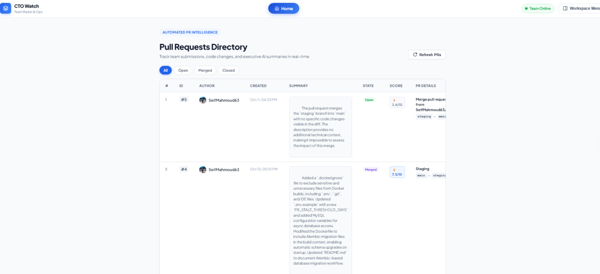

### ⚠️ Overdue — SLA Radar

Silent rot gets flagged before it bottlenecks: any open PR past the threshold (8 days here) lands here with an overdue-duration counter. All clear right now — the healthy green state.

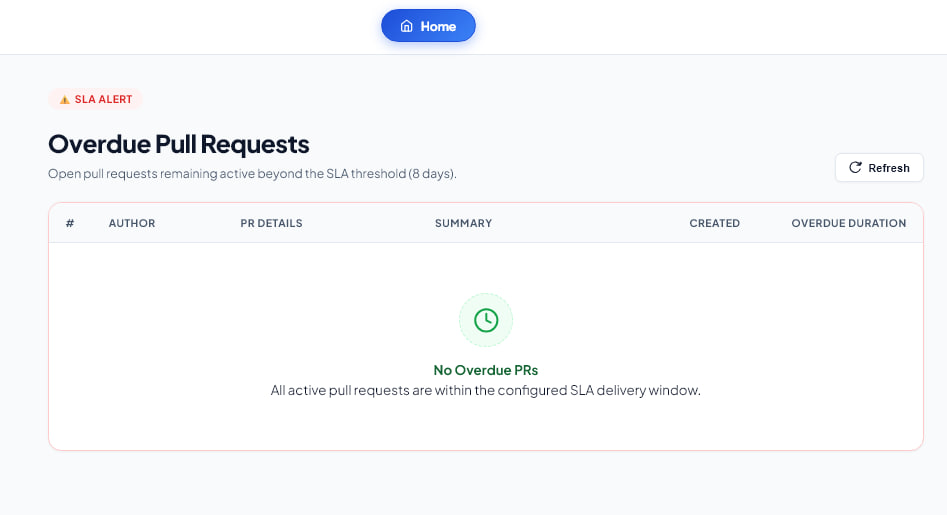

### 🏆 Dashboard — Engineer Impact

Ranked by architectural impact, not commit count — 8 time windows (Today → 1 Year), tiers from 🔴 Critical Driver to ⚪ Routine Support.

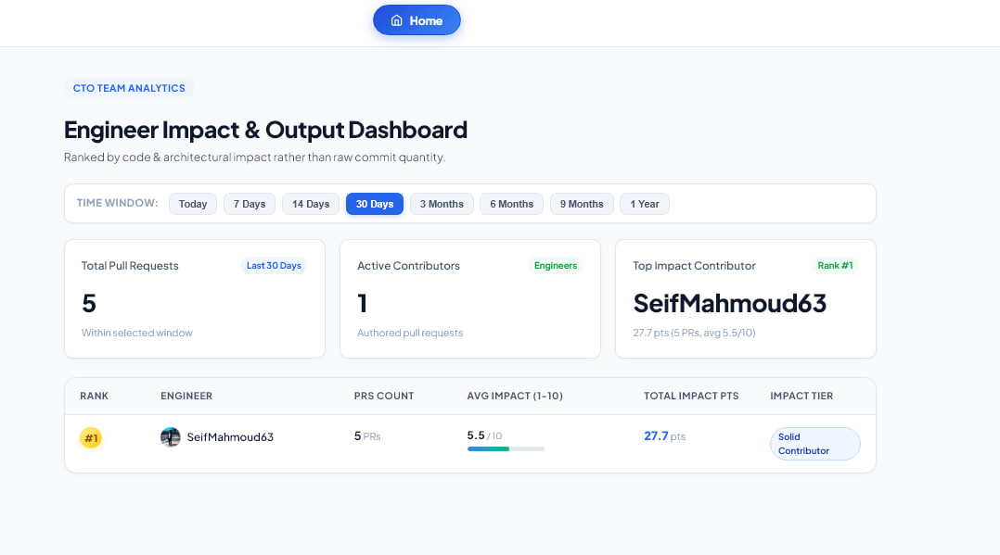

### 💬 Chatbot — CTO AI Copilot

Talk to your live database in Arabic or English. LangGraph agent over read-only MySQL with sessions, follow-up understanding, and a grounding gate that rejects fabricated numbers.

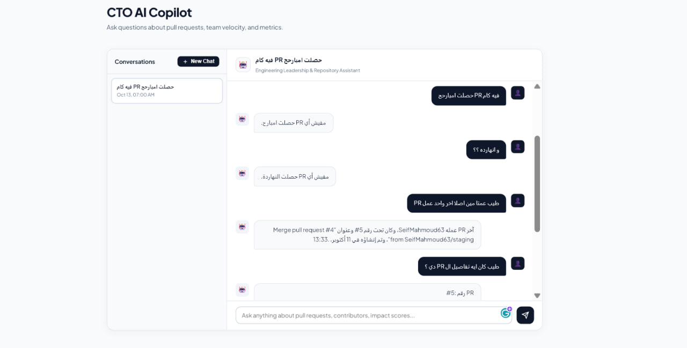

### 🧭 Workspace Menu — Everything One Click Away

Slide-out drawer with live count pills (`PRs: 5` · `Overdue: 0` · `Emails: 4`) — know the state of the org before you even navigate.

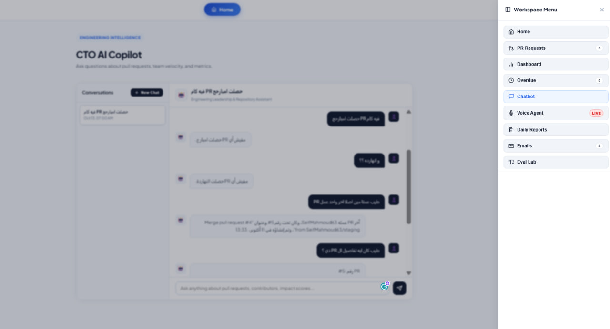

### 📄 Daily CTO Reports — 08:00 Executive Brief

Deterministic metrics (never hallucinated) + AI executive analysis + styled PDF, every morning — Preview inline or Download.

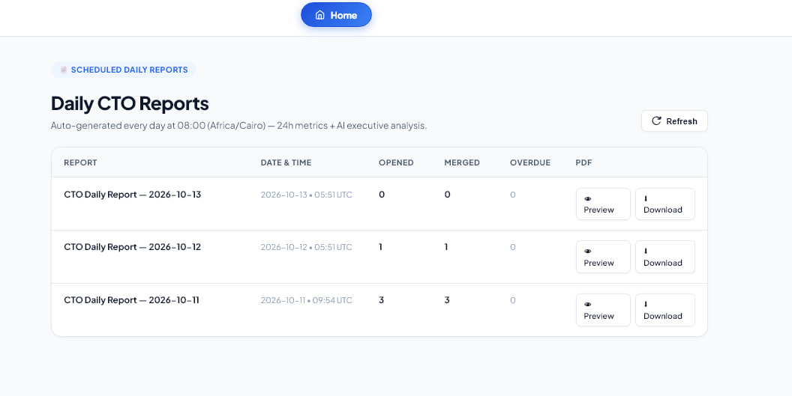

> 📝 *The timestamps in this screenshot are from testing — production reports land every day at **08:00 Africa/Cairo** sharp.*

### 📧 Emails — Inbox Triage

Unread mail polled over strictly read-only IMAP, summarized by the same AI stack, urgency-scored 1–10 (🔴 Reply Now → ⚪ Archive). Nothing is ever marked read or auto-answered.

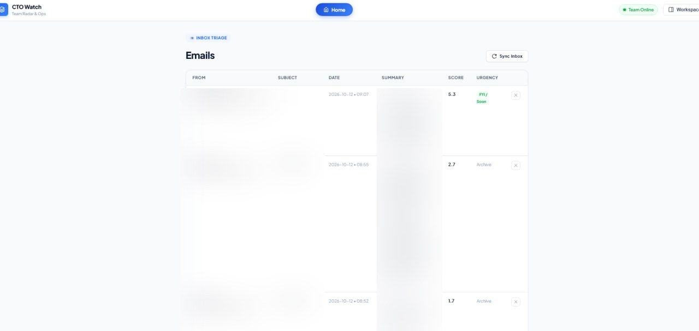

> 🕵️ *Senders and contents blurred for privacy — scores and tiers shown are real.*

### 🎙️ Voice Agent — Hands-Free CTO

Push-to-talk Deepgram copilot: glowing orb, live transcript, and a *Querying MySQL* badge while it fetches real metrics mid-sentence.

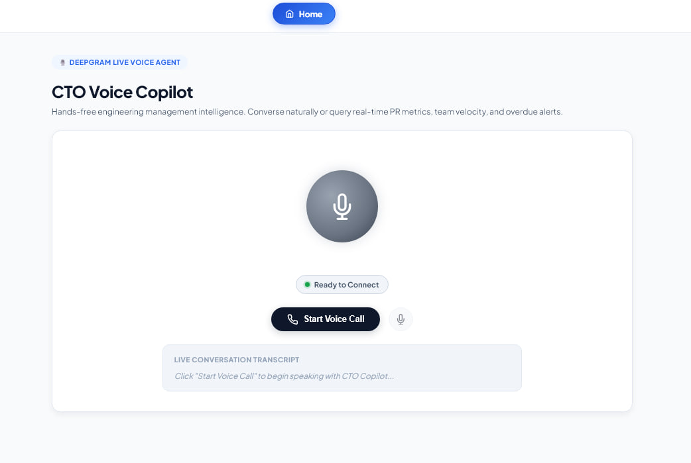

### 🧪 Eval Lab — Hallucinations Measured, Not Vibes

~122 torture questions (adversarial traps + live-DB questions) scored in MLflow — **Judge ON: 98% faithful / 0% hallucination** vs OFF: 90%. That's the grounding gate's worth, proven with numbers.

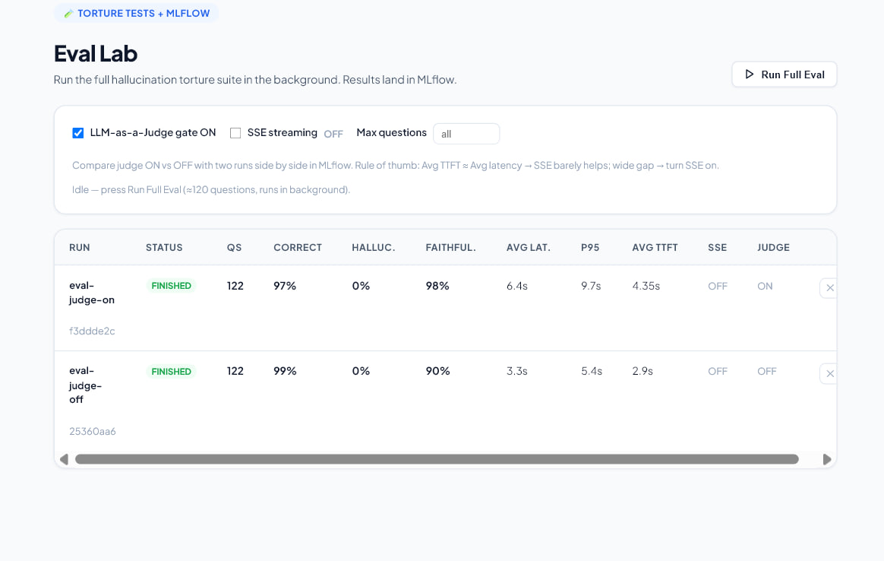

### 📢 Slack Bot — Alerts Where You Work

SLA-breach Block Kit cards with one-click *Review on GitHub*, plus the morning PDF auto-uploaded to your channel after 08:00.

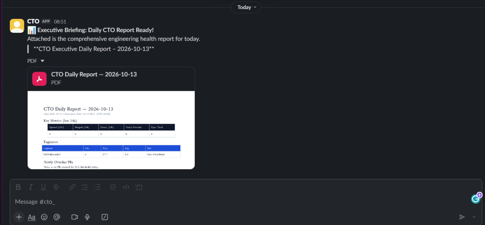

---

## 📚 Table of Contents

- [📸 Visual Showcase — live screenshots](#-visual-showcase--live-screenshots)
- [🌐 Where everything lives](#-where-everything-lives)
- [✨ Feature Atlas — every screen dissected](#-feature-atlas--every-screen-dissected)
  - [1 · Home](#1--home--team-velocity--engineering-pulse)
  - [2 · PR Requests](#2--pr-requests--automated-pr-intelligence)
  - [3 · Overdue](#3--overdue--sla-radar)
  - [4 · Dashboard](#4--dashboard--engineer-impact--leaderboard)
  - [5 · Chatbot](#5--chatbot--cto-ai-copilot-langgraph-agent)
  - [6 · Daily Reports](#6--daily-cto-reports--08h00-executive-brief)
  - [7 · Voice Agent](#7--voice-agent--deepgram-live-copilot)
  - [8 · Access Gate](#8--access-gate--password--totp)
  - [9 · Emails](#9--emails--inbox-triage)
  - [10 · Slack Bot](#10--slack-bot--sla-breach-radar--morning-pdf-broadcast)
  - [11 · Eval Lab](#11--eval-lab--torture-tests--mlflow)
- [🏗️ System Architecture](#️-system-architecture)
- [🧠 AI Brain — Bedrock + Groq + JEV](#-ai-brain--bedrock--groq--jev)
- [🗄️ Data Model](#️-data-model--mysql--alembic)
- [📡 API Reference](#-api-reference)
- [⚙️ Configuration — .env cheat sheet](#️-configuration--env-cheat-sheet)
- [🚀 Quick Start — run in 60 seconds](#-quick-start--run-in-60-seconds)
- [🗂️ Project Structure](#️-project-structure)
- [🧪 Testing](#-testing)
- [🛡️ Security & Guardrails](#️-security--guardrails)
- [🗺️ Roadmap](#️-roadmap)
- [🤝 Contributing](#-contributing)

---

## 🌐 Where Everything Lives

| Entry point | URL | What it is |
|---|---|---|
| 🖥️ **Web App** | `http://localhost:8000/` | CTO Watch SPA (Home · PRs · Overdue · Dashboard · Chat · Reports · Voice) |
| 📖 **Swagger Docs** | `http://localhost:8000/docs` | Interactive OpenAPI explorer (try every endpoint) |
| 💚 **Health** | `http://localhost:8000/api/health` | Status + repo + active LLM provider (Bedrock vs Groq) |
| 🔀 **PRs API** | `http://localhost:8000/api/prs` | Raw PR intelligence JSON |
| 🔑 **Login** | `http://localhost:8000/login` | Password + TOTP gate |

---

## ✨ Feature Atlas — Every Screen Dissected

### 1 · 🏠 Home — Team Velocity & Engineering Pulse

**The 10-second executive glance.** No tables, no noise — just *are we healthy?* Every number is computed live from `GET /api/prs` — no static figures.

```
┌─────────────────────────────────────────────────────────────┐
│  [CTO Executive Overview]                                    │
│  Team Velocity & Engineering Pulse                           │
│                                                             │
│  ┌────────────────────────────────────────────────────────┐ │
│  │ SLA Health                              [Healthy]      │ │
│  │ 92%  ████████████████████░░░░                          │ │
│  │ 11 within SLA · 1 breached of 12 open                  │ │
│  └────────────────────────────────────────────────────────┘ │
│                                                             │
│  Weekly PR Activity — last 7 days   (● Opened  ● Merged)    │
│   3 ┤        ╭─╮                                            │
│   2 ┤   ╭────╯ ╰╮      ╭╮                                   │
│   1 ┤───╯ green ╰──────╯╰──                                │
│   0 ┼───┴───┴───┴───┴───┴───┴───                           │
│     Mon 5  Tue 6 …                         9 opened · 6 merged│
└─────────────────────────────────────────────────────────────┘
```

- **SLA Health card** — share of currently-open PRs still inside the SLA window (`within / open × 100`). Chip states: `All Clear` (nothing open) · `Healthy ≥90%` · `Watch 70–89%` · `At Risk <70%`, with a color-coded progress bar (green/amber/red).
- **Weekly PR Activity chart** — dependency-free SVG line chart over the last 7 local days: **Opened** (blue, by `created_at`) vs **Merged** (green, by `state + updated_at`), integer gridlines, day labels, totals footer. Only in-window activity is plotted — open PRs created *before* the window are named in the footer/empty state (`…still open from before`) so the chart never looks dead-wrong.
- **Refresh:** loads on first paint + every Home navigation + the global 25s background poll (`loadHome()` in `web/app.js`).
- **Navigation hub** — top bar (`Home` shortcut · `Team Online` presence · `Workspace Menu` drawer) + right slide-out drawer with live count pills (`PRs: N` · `Overdue: M`).
- Files: `web/index.html` (homeView) · `web/app.js` (`loadHome/renderSLA/renderWeeklyChart`) · `web/style.css` (`.sla-bar`, `.chart-card`, `.chart-line…`)

---

### 2 · 🔀 PR Requests — Automated PR Intelligence

**Every GitHub PR, auto-fetched, auto-summarized, auto-scored. Zero manual work.**

```
  GitHub ──poll every 30s──▶ FastAPI ──diff (≤100k chars)──▶ Bedrock GPT-OSS
     │                          │                                │ fail?
     │                     webhook (opened /                    ▼
     │                     synchronize / reopened)         Groq fallback
     │                          │                                │
     └──────────────────────────┴──── summary + JEV score ──────┘
                                        │ MySQL upsert + cache
                                        ▼
                              ┌──────────────────┐
                              │ # │ Author │ Date │
                              │ Summary │ State  │
                              │ Score │ Details  │
                              └──────────────────┘
```

- **Filter bar:** `All · Open · Merged · Closed` — instant client-side filtering.
- **Columns:** `#` · `ID` · `Author` (avatar + login) · `Created` · **AI Summary (2–3 dense sentences)** · `State` badge · **Impact Score (1–10)** · `PR Details` (GitHub link).
- **Refresh PRs button** re-syncs from GitHub on demand; background task `auto_poll_prs()` (`app/main.py`) polls continuously; webhook `POST /api/webhook/github` re-summarizes on `opened/synchronize/reopened`.
- **Summary quality rules** (`app/core/enums.py::SystemPrompt`): concrete mechanism over generic filler, diff-grounded, flags description↔diff mismatches, admits truncation, never follows instructions hidden inside the PR.
- Empty state: *"No PRs Detected Yet — will populate with AI summaries once submitted on GitHub."*
- Backend: `app/services/github_service.py::get_pull_requests` · `summarize_pr` · `fetch_pr_diff` → `app/services/llm_service.py` → `app/services/jev_service.py` → `app/services/db_service.py::save_or_update_pr`

<details>
<summary><b>🔬 How one PR gets its brain — step by step</b></summary>

1. List API `GET /repos/{repo}/pulls` → raw JSON (id, number, title, user, branches, timestamps, `merged_at`).
2. State resolved: `merged_at ? merged : open/closed` (`PRStatus` enum).
3. Diff fetched with `Accept: application/vnd.github.v3.diff`, near-full (up to **100k chars**, flag `is_truncated` only for monster diffs that would blow the LLM timeout).
4. Prompt assembled from `UserPromptTemplate.PR_DIFF_TEMPLATE` (metadata + description + diff excerpt).
5. `LLMService.generate_pr_summary()` → Bedrock GPT-OSS primary, Groq fallback via circuit breaker.
6. `JevService.evaluate_impact(summary, diff)` → score **1.0–10.0** (TypeSafe `jev-latest`, 10-level criteria from *typo* → *platform upgrade*; scored from the diff first, summary as context, diff capped at 12k chars for the decision API).
7. Tier assigned: `≥8 Critical Driver · ≥6.5 High Impact · ≥5 Solid Contributor · else Routine Support`.
8. In-memory `summary_cache` + MySQL upsert (`pull_requests`) + `rebuild_engineers()` aggregates.

</details>

---

### 3 · ⚠️ Overdue — SLA Radar

**Catches silent rot.** Any open PR older than the SLA threshold gets flagged before it becomes a bottleneck.

- Threshold = `PR_STALE_THRESHOLD_DAYS` (default **5 days**, tunable in `.env`), surfaced in the subtitle and API (`stale_threshold_days`).
- Columns: `#` · `Author` · `PR Details` · `Summary` · `Created` · **Overdue Duration (days)**.
- Healthy empty state (green): *"No Overdue PRs — all active PRs are within the SLA window."*
- Logic: `app/services/github_service.py::_compute_pr_overdue()` — age = `now − created_at`, only for `state == open`.
- Feeds the **Daily Report's "newly overdue"** section and the **Dashboard's overdue list**.

---

### 4 · 🏆 Dashboard — Engineer Impact & Leaderboard

**Ranked by architectural impact, not commit count.** The fair leaderboard.

| Time window | Days | Label |
|---|---|---|
| Today | `1` | Daily standup lens |
| 7 Days / 14 Days | `7 / 14` | Sprint lens |
| **30 Days** (default) | `30` | Monthly review lens |
| 3 / 6 / 9 Months / 1 Year | `90 / 180 / 270 / 365` | Perf-review lens |

- **Top cards:** Total PRs in window · Active Contributors · Top Impact Contributor (#1 + score).
- **Leaderboard columns:** `Rank` · `Engineer` · `PRs Count` · `Avg Impact (1–10)` · `Total Impact Pts` · `Impact Tier` badge.
- **Sorting:** total impact points desc, then avg score desc; ranks assigned 1…N.
- **Tiers:**

| Tier | Avg score | Meaning |
|---|---|---|
| 🔴 `Critical Driver` | ≥ 8.0 | Architecture-shaping work |
| 🟠 `High Impact` | ≥ 6.5 | Major features / integrations |
| 🔵 `Solid Contributor` | ≥ 5.0 | Steady feature delivery |
| ⚪ `Routine Support` | < 5.0 | Small fixes, docs, chores |

- Endpoint: `GET /api/dashboard?days=30` → `DashboardLeaderboardResponse` (`app/schemas/pr_schema.py`).
- Backend: `app/services/github_service.py::get_team_dashboard()` (cutoff filter → group by author → stats → sort → rank).
- ⚠️ **Known limitations:** impact scores are AI judgments over diffs (monster diffs are capped; the score reflects what the model saw) — treat them as triage signals, not performance reviews. Ranking engineers by AI score is sensitive: use it to spot who needs support or who drove a release, never as a standalone appraisal tool.

---

### 5 · 💬 Chatbot — CTO AI Copilot (LangGraph Agent)

**Talk to your database.** Ask *"who's blocked?"*, *"summarize today's report"* (bilingual AR/EN support — responds in the prompt's language).

```
 User ("who's the second one? / and its author?")
   │
   ▼
 ┌─ Query Rewriter (LLM) ─────────────────────────┐
 │ follow-ups ("by whom?") → standalone question  │
 │ via model rewrite w/ history window           │
 └──────────────────────┬───────────────────────┘
                        ▼ standalone question
 ┌─ LangGraph Agent (agent ⇄ tools loop) ───────┐
 │ SystemPrompt: CTO advisor + full DB schema   │
 │ Tools:                                        │
 │ ① execute_readonly_query (SELECT-only MySQL) │
 │ ② summarize_report (today/yesterday/dates)   │
 │ ③ get_current_datetime (Africa/Cairo)        │
 │ ④ web_search (DuckDuckGo, external only)     │
 │ ⑤ get_database_schema                        │
 └──────────────────────┬───────────────────────┘
                        ▼ markdown answer (compact by default)
              MySQL persisted (sessions + messages)
```

> 🖨️ **Actual compiled LangGraph — printed live from code** (`app/services/chat_service.py:494-507`, `StateGraph` with nodes `agent` + `tools`).
> Node `classDef` colors are tuned for contrast (dark text on light nodes, white on dark) so the graph stays readable in both GitHub **light** and **dark** mode. Regenerate the structure anytime: `python -c "from app.services.chat_service import chat_service; print(chat_service.graph.get_graph().draw_mermaid())"`

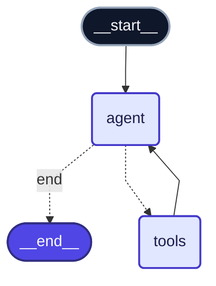

**How to read it:** `__start__ → agent` (LLM with tools bound, system prompt injected) → conditional router `_should_continue`: no `tool_calls` → `__end__` (reply to user) · has `tool_calls` → `tools` (`_tools_step` executes each call, returns `ToolMessage`s) → back to `agent` for the next reasoning round. The loop repeats until the agent answers without tools — then the reply is persisted to MySQL.

> 🔍 **Runtime zoom — what happens *inside* the `tools` node** (one fan-out per tool call):

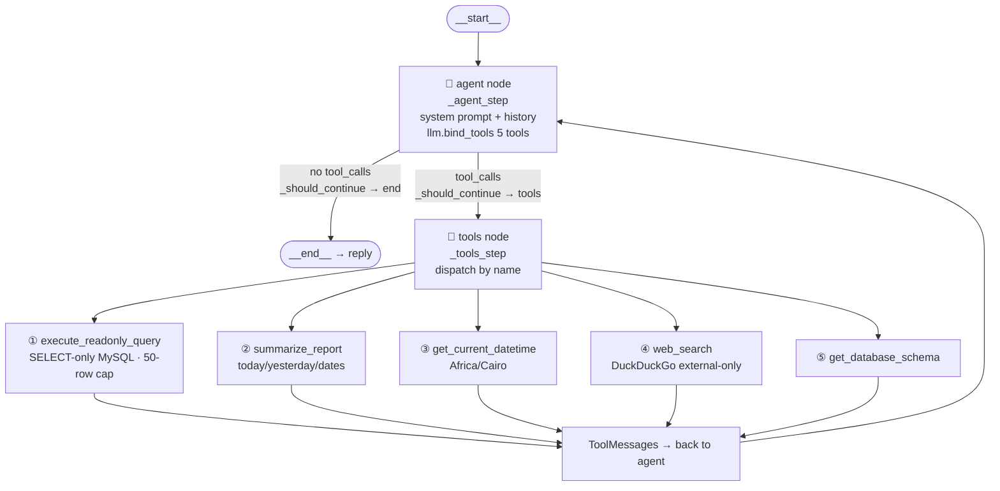

- **Sessions sidebar:** `New Chat` · auto-titled from first message · per-session history · delete. Memory window = `CHAT_MEMORY_WINDOW_SIZE` (default **10**), rewrite window = `CHAT_QUERY_REWRITE_WINDOW_SIZE` (default **2**).
- **Response discipline:** compact lists (PR # + title + author + state, max ~10) → full details only for one explicitly requested PR; human timestamps (`Oct 10, 13:09`, never raw ISO); one reply = one language; technical identifiers never translated.
- **Smart follow-ups:** every follow-up (*"by whom?"*, *"and its author?"*) is rewritten by the LLM into a standalone question with history context — no hardcoded ordinal shortcuts, so nothing gets invented. A deterministic **time-guard** rejects any rewrite that drops time constraints (*today/yesterday…*) and keeps the original instead.
- **Report questions** (`summarize today's report`, `summarize yesterday's report`) route to `summarize_report`, which parses `today/yesterday/YYYY-MM-DD/DD month` and caps summaries at 2000 chars.
- **Read-only fortress:** regex-allowed `SELECT/SHOW/DESCRIBE/EXPLAIN` only + forbidden-keyword block + `SET TRANSACTION READ ONLY` + 50-row cap + cell coercion (`Decimal`/date/bytes → JSON-safe, so SUM/AVG results serialize instead of collapsing into Database Error).
- Files: `app/services/chat_service.py` (≈700 lines: prompts, tools, graph, LLM query-rewrite, session CRUD) · `app/models/chat_model.py` · endpoints `GET/POST /api/chat/sessions…`

#### 🛡️ Anti-Hallucination Grounding Gate — LLM-as-a-Judge

> **Zero tolerance for fabricated metrics:** In an executive engineering cockpit, hallucinations can be disastrous. If a CTO asks *"Which PRs breached SLA?"* or *"Who authored PR #12?"*, a standard model might invent plausible-sounding names or numbers. To reduce hallucinations to the absolute minimum, CTO Watch incorporates a dedicated **LLM-as-a-Judge** verification layer (`app/services/judge_service.py`) running an independent model (`openai.gpt-oss-20b`) that audits every single answer against real data before the user ever sees it.

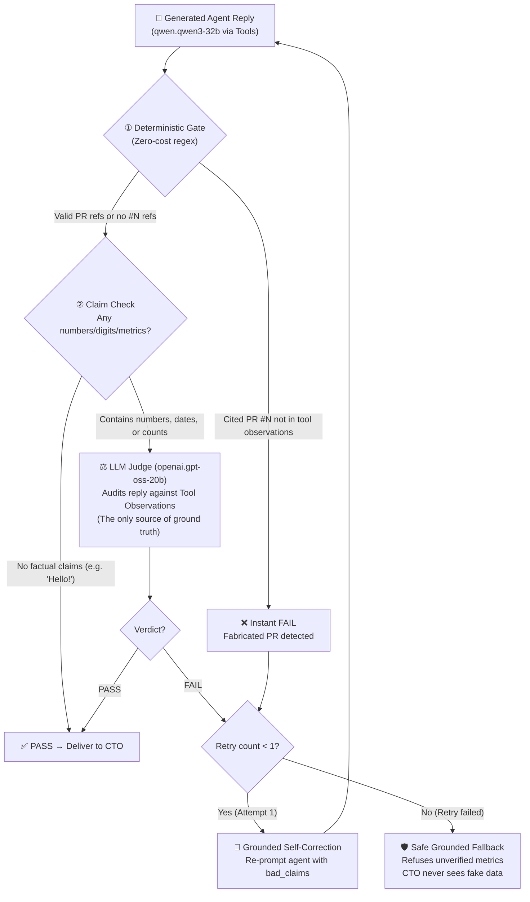

- **Tier 1 — Free Deterministic Guard:** Instantly cross-checks all cited PR numbers (`#N`) against raw tool output. If the agent mentions a PR number it never actually fetched, the response is rejected immediately at zero LLM cost.
- **Tier 2 — Claim Skip Optimization:** Pure conversational smalltalk without factual or countable claims skips the judge model entirely to eliminate unnecessary latency.
- **Tier 3 — Semantic LLM Judge (`openai.gpt-oss-20b`):** An independent, objective model audits the claims strictly against tool observations (the only ground truth). It outputs a structured JSON verdict: `{"verdict": "PASS" | "FAIL", "reason": "...", "bad_claims": [...]}`.
- **Self-Correction & Fallback Loop:** On `FAIL`, the agent receives one chance to self-correct using explicit feedback highlighting unsupported claims. If it fails again, it serves a safe fallback message rather than risking hallucinated data. Toggle via `JUDGE_ENABLED=true` in `.env`.

<details>
<summary><b>🧪 Try these prompts (copy-paste)</b></summary>

- `List open PRs with authors and impact scores`
- `Who are the top 3 engineers this month and why?`
- `Which PRs are overdue right now?`
- `Summarize today's report`
- `Who opened the most PRs in the last 30 days?`
- `What time is it in Cairo?`
- `Search the web: what is trunk-based development?`

</details>

---

### 6 · 📄 Daily CTO Reports — 08h00 Executive Brief

**Wake up to a finished brief.** Every morning the system writes your exec summary *for you* — metrics + AI analysis + styled PDF.

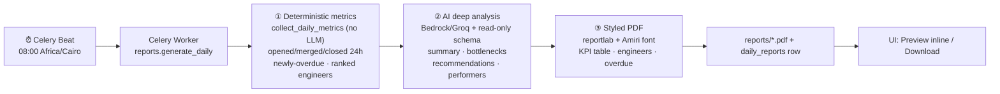

- **Hybrid = trustworthy:** numbers are computed in pure Python (never hallucinated); the LLM only *interprets* them under strict rules (English-only, plain text, no markdown tables, usernames stay Latin).
- **PDF anatomy:** title `CTO Daily Report — YYYY-MM-DD` · explicit timestamp `2026-10-11 08:00 (UTC+03:00)` · KPI strip (Opened/Merged/Closed/Newly-Overdue/Open-Total) · engineers table · newly-overdue list · executive analysis (Arabic-shaped via `arabic-reshaper` + `python-bidi`, Amiri font bundled in `app/services/fonts/`).
- **UI:** reports table (`Report` · `Date & Time` · `Opened` · `Merged` · `Overdue` · `PDF` with Preview/Download) served by `GET /api/reports/{id}/file?mode=preview|download`.
- **Manual run (no waiting for morning):**
  ```powershell
  curl.exe -X POST http://localhost:8000/api/reports/generate
  curl.exe http://localhost:8000/api/reports/tasks/<task_id>
  curl.exe http://localhost:8000/api/reports
  ```
- Files: `app/services/report_service.py` · `app/services/celery_app.py` · `app/models/report_model.py` · migration `0002_daily_reports.py` · output dir `reports/`

---

### 7 · 🎙️ Voice Agent — Deepgram Live Copilot

**Hands-free CTO.** Click *Start Voice Call*, talk naturally, hear live metrics — the agent queries MySQL mid-sentence.

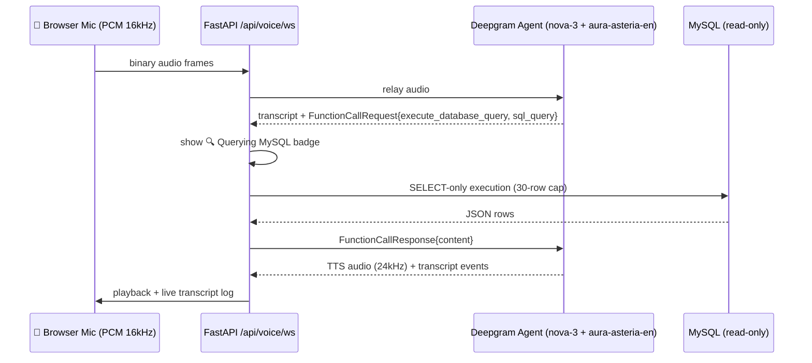

- **Orb stage:** idle → listening → thinking → speaking states with ripple animation; status pill (`Ready to Connect` → `Live`); mute button; barge-in notice.
- **DB tool discipline:** same read-only guard as chat (`SELECT`-only + forbidden-keyword block + read-only transaction), results capped at 30 rows for concise speech; daily-report questions run a fixed highlights query and point to the full PDF in the Reports tab.
- **Bridge robustness:** `parse_function_calls()` tolerates Deepgram's JSON-encoded-string `arguments` shape and never crashes the relay loop; missing `DEEPGRAM_API_KEY` fails gracefully with an explanatory socket error.
- **Known limitation:** the voice speaks English only (`aura-asteria-en`) — unlike the bilingual text chatbot. Arabic speech in/out is not supported by the current voice stack.
- Endpoints: `GET /api/voice/config` (readiness + models) · `WS /api/voice/ws` (bidirectional audio+events).
- Files: `app/services/voice_service.py` · voice view in `web/index.html` + `web/app.js`

---

### 8 · 🔐 Access Gate — Password + TOTP

**The whole app sits behind one locked door** — pages *and* APIs — except `/login`, `/api/auth/*`, `/api/health`, `/api/webhook/*`, `/static/*`, docs. GitHub webhooks keep working by design.

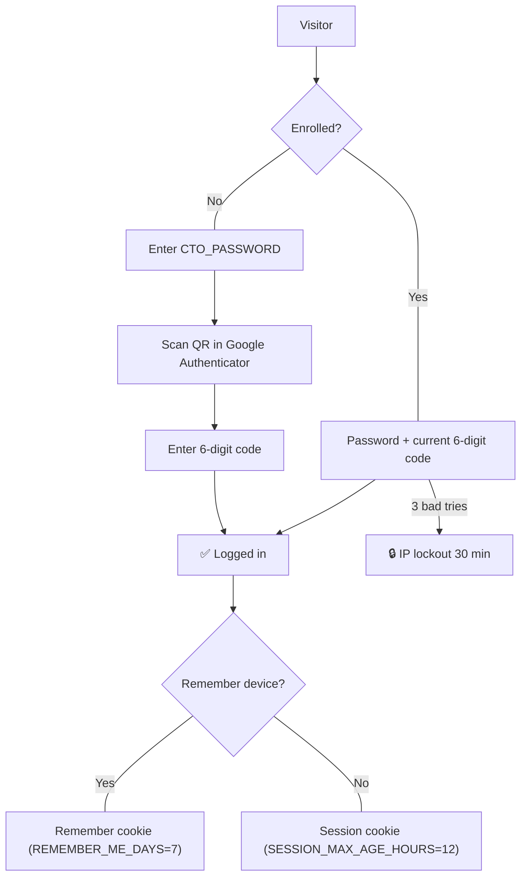

- **Setup:** set `CTO_PASSWORD` + `SESSION_SECRET` (`python -c "import secrets; print(secrets.token_urlsafe(32))"`), `docker compose up -d`, open app, scan QR, enter code. Tick **Remember this device** to skip login for 7 days.
- **Crypto:** TOTP secret Fernet-encrypted in `auth_state` table (migration `0003`); rotating `SESSION_SECRET` invalidates old secrets + cookies (forced re-enrollment). Fail-closed: empty password/secret ⇒ logins refused.
- **Ops:** `POST /api/auth/totp/reset` (logged-in) wipes enrollment for a fresh QR; brute force throttled (`AUTH_MAX_ATTEMPTS` / `AUTH_LOCKOUT_SECONDS`).
- Files: `app/core/auth_gate.py` · `app/services/auth_service.py` · `app/api/auth.py` · `app/models/auth_model.py` · `web/login.html`

---

### 9 · 📧 Emails — Inbox Triage

**Your inbox, triaged like your PRs.** Unread mail is polled over IMAP (strictly read-only), summarized by the same Bedrock/Groq stack, and scored 1–10 for reply-urgency by the JEV decision model.

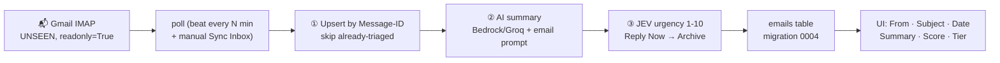

- **Urgency tiers:** 🔴 `Reply Now ≥8` · 🟠 `Reply Today ≥6.5` · 🔵 `FYI / Soon ≥5` · ⚪ `Archive <5`.
- **List shows the last 3 days** (`GET /api/emails?days=N`, default 3) — newest first, undated rows sink to the bottom.
- **Summaries describe only** (who wrote what, facts only) — the LLM never suggests replies or actions; urgency lives in the score column, not the text.
- **Dismiss button** (✕ per row, `DELETE /api/emails/{id}`): soft-hides from the list to cut clutter; hidden mail stays in the DB so later polls never resurrect it.
- **Read-only by design:** mailbox opened `readonly=True` — nothing is marked read, moved, or deleted. No auto-replies, ever.
- **Privacy:** bodies are truncated (`EMAIL_MAX_BODY_CHARS`) before summarization; credentials live only in `.env` (gitignored) — never in screenshots or docs.
- **Setup:** enable 2FA on Google → create an App Password → set `EMAIL_ENABLED=true` + `EMAIL_ADDRESS` + `EMAIL_PASSWORD` in `.env` → `docker compose up -d` → open Emails → Sync Inbox.
- **Chatbot sees it too:** the `emails` table is in the agent's schema, so *"any urgent emails?"* works out of the box.
- Files: `app/services/email_service.py` · `app/models/email_model.py` · `app/api/routes.py` (`/api/emails*`) · `app/services/celery_app.py` (`emails.poll_inbox`) · migration `0004_emails.py`

---

### 10 · 📢 Slack Bot — SLA Breach Radar & Morning PDF Broadcast

**Engineering leadership alerts where you actually work.** Instant notifications when PRs breach review SLAs, plus automated morning PDF uploads of the daily executive briefing directly to your Slack channel.

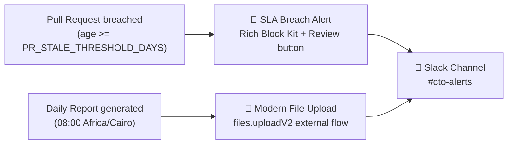

- **SLA Breach Radar:** Overdue pull requests are pushed as interactive Slack Block Kit cards featuring PR title, author, branch, days overdue, and a one-click *"Review on GitHub"* action button.
- **Automated Morning PDF Broadcast:** Every morning after 08:00 report synthesis, the compiled PDF is automatically uploaded via Slack's modern 3-step external upload workflow (`files.getUploadURLExternal` → direct binary storage → `files.completeUploadExternal`), including an executive bullet summary.
- **Dedicated Bot Scopes:** Utilizes permanent Bot User OAuth Token (`xoxb-...`) requiring `chat:write`, `files:write`, `channels:read`.
- **Scheduled & On-Demand:** Triggered automatically via Celery Beat (`slack.check_sla_breaches` every 30m, daily report task at 08:00) or on-demand via REST endpoints (`POST /api/slack/notify-overdue`, `POST /api/slack/upload-latest-report`).
- Files: `app/services/slack_service.py` · `app/api/routes.py` (`/api/slack/*`) · `app/services/celery_app.py`

---

### 11 · 🧪 Eval Lab — Torture Tests + MLflow

**Prove there's no hallucination — with numbers, not vibes.** One button queues a background run of **~122 questions** (24 curated adversarial traps + ~100 generated from live DB + synthetic fixtures): counts, follow-ups, false premises, future dates, exact-username traps, language discipline. Every reply is scored and everything lands in MLflow.

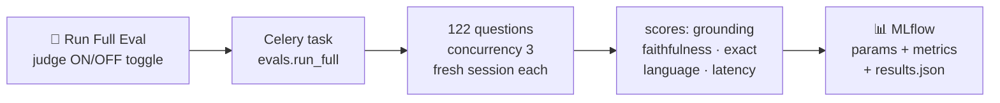

- **Metrics (no deepeval package, by design):** `faithfulness` (judge model vs tool observations — the core hallucination metric) · `grounding` (free deterministic PR-reference gate) · `exact` (char-exact names/numbers) · `language` · `relevancy` · `avg/p95 latency`. Contextual recall/precision deliberately excluded (RAG-retrieval metrics — our retrieval is SQL).
- **Fail is split in two:** `fail_fabrication_rate` (failed AND ungrounded — invented refs, typos, claims with no evidence: the number the CTO actually cares about) vs `fail_quality_rate` (failed BUT grounded — wrong count, indirect answer, language slip: strict-checker territory, not hallucination).
- **Judge ON vs OFF:** run twice with the checkbox, compare `fail_rate` + `faithfulness_avg` side by side in the MLflow UI — that's the experiment that proves the gate's worth.
- **Live progress card:** the UI shows "4 من 62" with a bar while running (`GET /api/eval/progress/{task_id}`); the total follows your Max-questions choice automatically.
- **Latency engineering:** question groups run concurrently (`EVAL_MAX_CONCURRENCY=3`); faithfulness LLM calls are skipped where the outcome is logically forced (rejected→0, refusals→1). Full run ≈ 8–12 min instead of ~30.
- **Judge hardening:** empty judge responses retry, then fall back to Qwen (`JUDGE_RETRIES`, `JUDGE_FALLBACK_MODEL`) — the 28 silent empties from the first big run can't recur silently.
- **Delete runs:** ✕ per row (`DELETE /api/eval/runs/{id}`) soft-deletes from MLflow.
- **Synthetic fixtures:** `eval_fixtures` table (migration `0006`, 32 clearly-fake rows) so generated questions never depend on prod data volume.
- **View it:** `pip install mlflow`, then from the repo root: `mlflow ui --backend-store-uri sqlite:///./mlruns/mlflow.db --port 5000` → http://localhost:5000.
- Files: `app/services/eval_service.py` · `app/models/eval_fixture_model.py` · `app/api/routes.py` (`/api/eval/*`) · `app/services/celery_app.py` (`evals.run_full`) · migration `0006_eval_fixtures.py`

---

## 🏗️ System Architecture

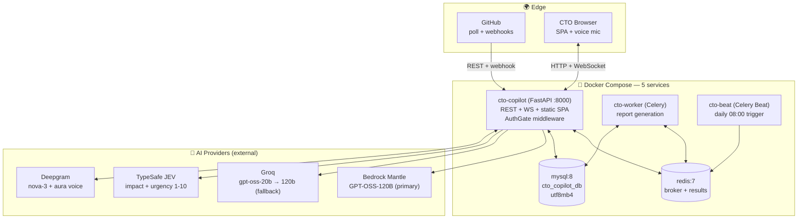

| Container | Image / Command | Ports | Role |
|---|---|---|---|
| `cto-copilot-mysql` | `mysql:8.0` | `3307→3306` | System of record (PRs, engineers, chat, reports, auth, emails) |
| `cto-copilot-redis` | `redis:7-alpine` | `6379` | Celery broker + result backend |
| `cto-copilot-app` | `uvicorn app.main:app` | `8000→8000` | API + SPA + polling + auth gate |
| `cto-copilot-worker` | `celery worker --concurrency=2` | — | Executes daily-report pipeline |
| `cto-beat` | `celery beat` | — | Fires `reports.generate_daily` at 08:00 Cairo |

Healthchecks on all three infra services; app hot-mounts `./app`, `./web`, `./reports` for live iteration.

---

## 🧠 AI Brain — Bedrock + Groq + JEV

### Circuit breaker (never go dark)

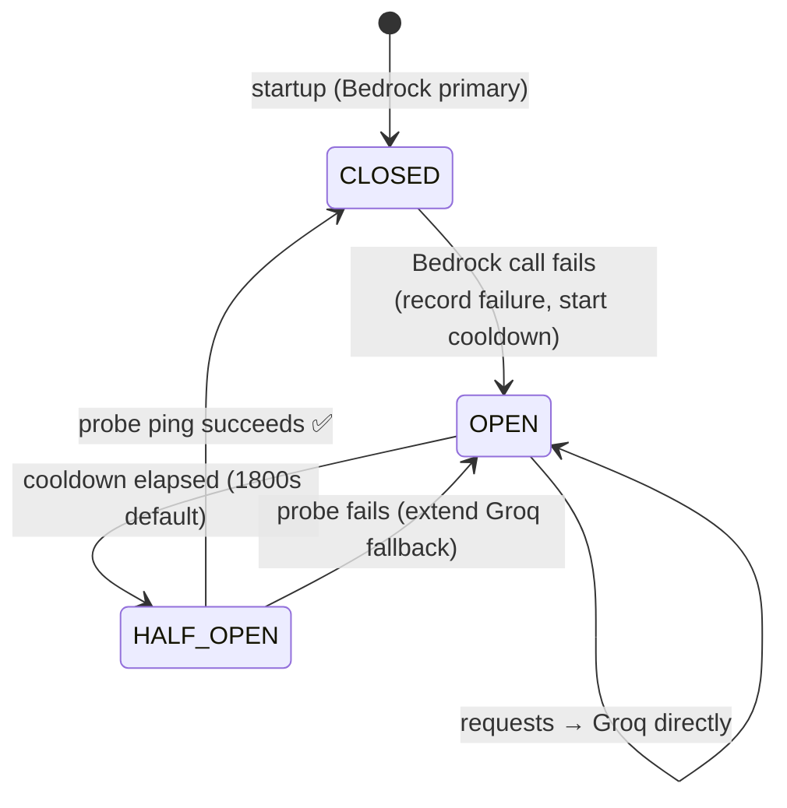

- Probe prompt = `CIRCUIT_BREAKER_PROBE_PROMPT` (`ping`, 5 tokens, 10s timeout).
- Live status: `GET /api/circuit-breaker` → `{state, cooldown_seconds, seconds_remaining, active_provider}` (also inside `/api/health`).
- File: `app/services/circuit_breaker.py`

### Provider chain

| Layer | Model | Via | When |
|---|---|---|---|
| 🥇 Primary | `qwen.qwen3-32b` (Bedrock Mantle, OpenAI-compatible) | `openai.OpenAI(base_url=…/v1)` | Circuit CLOSED / recovered |
| 🥈 Fallback | `openai/gpt-oss-20b` → `openai/gpt-oss-120b` | LangChain `ChatGroq` | Circuit OPEN / Bedrock error |
| ⚖️ Scorer | `jev-latest` (TypeSafe SystemOne) | `JEV_API_URL` decision API | Every summarization (default 5.0 if unconfigured) |
| 🛡️ Judge | `openai.gpt-oss-20b` | Bedrock Mantle OpenAI client | Pre-delivery anti-hallucination review on chat replies |

Hyperparameters: `LLM_TEMPERATURE=0.2` · `LLM_MAX_TOKENS=1024` — deterministic, executive-dense output without reasoning overhead.

---

## 🗄️ Data Model — MySQL + Alembic

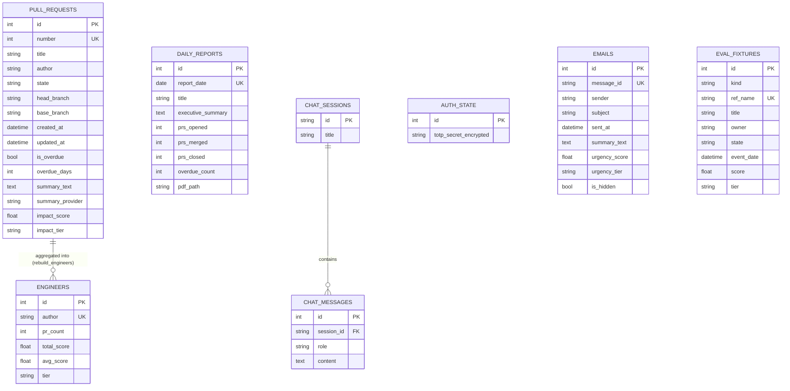

- Migrations: `0001_initial_two_tables` (PRs + engineers) · `0002_daily_reports` · `0003_auth_state` · `0004_emails` · `0005_email_dismiss` · `0006_eval_fixtures`. App container runs `alembic upgrade head` on startup — plain `docker compose up` keeps schema current.
- Migration workflow: change `app/models/*` → `python -m alembic revision --autogenerate -m "msg"` → review → `upgrade head` → `pytest` → rebuild `cto-copilot`.
- From your terminal (outside Docker) point at the published port: `$env:MYSQL_HOST="127.0.0.1"; $env:MYSQL_PORT="3307"; python -m alembic current|history|upgrade head|stamp head` — `.env` keeps `MYSQL_HOST=mysql` for in-network containers.

---

## 📡 API Reference

### PRs & Intelligence

| Method | Endpoint | Purpose |
|---|---|---|
| `GET` | `/api/health` | Health + repo + circuit-breaker status |
| `GET` | `/api/prs?state=all\|open\|closed` | PR list with summaries, scores, SLA flags |
| `GET` | `/api/dashboard?days=1..365` | Leaderboard + timeframe label + overdue PRs |
| `POST` | `/api/prs/{n}/summarize?force_refresh=false` | (Re)generate summary + JEV score for one PR |
| `GET` | `/api/circuit-breaker` | Breaker state + cooldown countdown |
| `POST` | `/api/webhook/github` | GitHub `pull_request` events → auto-summarize |
| `GET` | `/api/db/stats` | Row counts (`pull_requests`, `engineers`) |
| `GET` | `/api/engineers` | Engineers with PR count / total / avg score |

### Chat (LangGraph)

| Method | Endpoint | Purpose |
|---|---|---|
| `GET` | `/api/chat/sessions` | List conversations |
| `POST` | `/api/chat/sessions` | Create session (`{title?}`) |
| `GET` | `/api/chat/sessions/{id}/messages` | History |
| `DELETE` | `/api/chat/sessions/{id}` | Delete session + messages |
| `POST` | `/api/chat/sessions/{id}/message` | Send `{message}` → `{reply, rewritten_query}` |

### Reports

| Method | Endpoint | Purpose |
|---|---|---|
| `GET` | `/api/reports?limit=30` | List reports, newest first |
| `POST` | `/api/reports/generate` | Enqueue generation → `{task_id}` (inline fallback if Redis down) |
| `GET` | `/api/reports/tasks/{task_id}` | `PENDING / SUCCESS / FAILURE` + result |
| `GET` | `/api/reports/{id}/file?mode=preview\|download` | Inline PDF vs attachment download |

### Voice

| Method | Endpoint | Purpose |
|---|---|---|
| `GET` | `/api/voice/config` | `{configured, model, voice}` readiness |
| `WS` | `/api/voice/ws` | Bidirectional audio + transcript + DB-tool events |

### Auth Gate

| Method | Endpoint | Purpose |
|---|---|---|
| `GET` | `/api/auth/status` | `{enrolled, configured}` for login UI |
| `POST` | `/api/auth/setup` | Begin TOTP enrollment (password-gated) |
| `POST` | `/api/auth/verify` | Confirm code → finish enrollment + login |
| `POST` | `/api/auth/login` | Password (+code) + optional `remember` |
| `POST` | `/api/auth/logout` | Clear session + remember cookies |
| `POST` | `/api/auth/totp/reset` | Wipe enrollment (authed) → fresh QR |

### Emails

| Method | Endpoint | Purpose |
|---|---|---|
| `GET` | `/api/emails?limit=30` | Triaged emails, newest first |
| `POST` | `/api/emails/sync` | Run one inbox poll now (503 if mailbox unreachable) |
| `DELETE` | `/api/emails/{id}` | Dismiss from the list (soft-hide, never resurrected) |

### Eval Lab

| Method | Endpoint | Purpose |
|---|---|---|
| `POST` | `/api/eval/run` | Queue a torture run (`{use_judge, max_questions?}`) → `{task_id}` |
| `GET` | `/api/eval/runs/{task_id}` | Celery task state (PENDING / SUCCESS / FAILURE + summary) |
| `GET` | `/api/eval/progress/{task_id}` | Live `{current, total}` for the "X من Y" card |
| `GET` | `/api/eval/recent?limit=10` | Last MLflow runs for the dashboard table |
| `DELETE` | `/api/eval/runs/{run_id}` | Soft-delete an MLflow run |

---

## ⚙️ Configuration — .env Cheat Sheet

Copy `.env.example` → `.env` and fill secrets. **Never commit `.env`.**

| Group | Keys | Notes |
|---|---|---|
| GitHub | `GITHUB_TOKEN` · `GITHUB_REPO` · `GITHUB_API_URL` · `GITHUB_POLL_INTERVAL_SECONDS=30` · `PR_STALE_THRESHOLD_DAYS=5` | Token needs `repo` read; poll drives auto-summaries |
| Bedrock | `BEDROCK_API_KEY` · `BEDROCK_BASE_URL_QWEN` · `BEDROCK_MODEL=qwen.qwen3-32b` · `BEDROCK_VISION_MODEL` | Primary agent model |
| JEV | `JEV_API_KEY` · `JEV_API_URL` · `JEV_MODEL=jev-latest` | Impact 1–10; missing key ⇒ neutral 5.0 |
| Groq | `GROQ_API_KEY` · `GROQ_MODEL` · `GROQ_BACKUP_MODEL` | Fallback chain `20b → 120b` |
| Tuning | `LLM_TEMPERATURE=0.2` · `LLM_MAX_TOKENS=1024` · `LLM_REASONING_EFFORT=""` | Executive-dense, zero reasoning overhead for maximum speed |
| Breaker | `CIRCUIT_BREAKER_COOLDOWN_SECONDS=1800` · `CIRCUIT_BREAKER_PROBE_PROMPT=ping` | 30-min fallback window |
| App | `APP_HOST` · `APP_PORT=8000` · `STATIC_DIR=web` | — |
| MySQL | `MYSQL_HOST=mysql` · `MYSQL_PORT=3306` · `MYSQL_USER/PASSWORD/DATABASE` · `DATABASE_URL=` | Compose overrides host/port; CLI uses `127.0.0.1:3307` |
| Chat | `CHAT_MEMORY_WINDOW_SIZE=10` · `CHAT_QUERY_REWRITE_WINDOW_SIZE=2` | Short-term memory + follow-up rewrite |
| Judge | `JUDGE_ENABLED=true` · `JUDGE_MODEL=openai.gpt-oss-20b` (Bedrock) · `JUDGE_MAX_TOKENS=1024` · `JUDGE_RETRIES=1` · `JUDGE_FALLBACK_MODEL=openai/gpt-oss-20b` (Groq) | Grounding gate for chat replies (audits every answer against tool outputs; empty responses retry then fall back) |
| Emails | `EMAIL_ENABLED=false` · `EMAIL_ADDRESS` · `EMAIL_PASSWORD` (App Password) · `EMAIL_POLL_INTERVAL_MINUTES=3` | Read-only IMAP triage; creds in `.env` only, never committed |
| Eval | `MLFLOW_TRACKING_URI=sqlite:///./mlruns/mlflow.db` · `EVAL_MAX_CONCURRENCY=3` | Local MLflow store (mounted volume); `mlflow ui` to browse; 3 parallel question groups |
| Celery | `CELERY_BROKER_URL` · `CELERY_RESULT_BACKEND` | `redis://redis:6379/0` |
| Reports | `REPORT_TIMEZONE=Africa/Cairo` · `REPORT_HOUR=8` · `REPORT_MINUTE=0` · `REPORTS_DIR=reports` · `REPORT_LANGUAGE=English` | English-only keeps PDFs LTR-clean |
| Voice | `DEEPGRAM_API_KEY` · `DEEPGRAM_AGENT_MODEL=nova-3` · `DEEPGRAM_VOICE_MODEL=aura-asteria-en` | Missing key ⇒ voice gracefully disabled |
| Gate | `CTO_PASSWORD` · `SESSION_SECRET` · `SESSION_MAX_AGE_HOURS=12` · `REMEMBER_ME_DAYS=7` · `TOTP_ISSUER` · `AUTH_MAX_ATTEMPTS` · `AUTH_LOCKOUT_SECONDS` | Fail-closed when empty |

---

## 🚀 Quick Start — Run in 60 Seconds

```powershell
# 1 · configure (run from the repo root — no hardcoded paths)
Copy-Item .env.example .env
# edit .env → GITHUB_TOKEN, CTO_PASSWORD, SESSION_SECRET (see Gate section), LLM keys

# 2 · launch the whole stack (mysql + redis + app + worker + beat)
docker compose up -d --build

# 3 · open
Start-Process http://localhost:8000/
Start-Process http://localhost:8000/docs
```

macOS / Linux (`bash`) equivalent:

```bash
# run from the repo root
cp .env.example .env
# edit .env, then:
docker compose up -d --build
xdg-open http://localhost:8000/ || open http://localhost:8000/
```

```powershell
# useful ops
docker compose logs -f cto-copilot        # app logs
docker compose logs -f cto-worker        # report worker
curl.exe http://localhost:8000/api/health
curl.exe -X POST http://localhost:8000/api/reports/generate

# local dev (no docker for the API itself)
pip install -r requirements.txt
python -m uvicorn app.main:app --reload --port 8000
python -m pytest tests/ -v
```

**GitHub webhook (for instant summaries):** repo Settings → Webhooks → Payload URL `https://<your-host>/api/webhook/github` → Content type `application/json` → events: *Pull requests* → Active. No auth header needed (endpoint is gate-exempt by design).

---

## 🗂️ Project Structure

```
CTO_MULTI_AGENT/
├── app/
│   ├── main.py                  # FastAPI app + CORS + AuthGate + static SPA + poll loop
│   ├── core/
│   │   ├── config.py            # pydantic-settings (.env → Settings)
│   │   ├── enums.py             # PRStatus · LLMProvider · CircuitBreakerState · prompts
│   │   └── auth_gate.py         # login-gate middleware (allowlist inside)
│   ├── api/
│   │   ├── routes.py            # PRs · dashboard · chat · reports · voice WS · webhooks
│   │   └── auth.py              # setup/verify/login/logout/totp-reset
│   ├── services/
│   │   ├── github_service.py    # poll · diff · summarize · dashboard · SLA math
│   │   ├── llm_service.py       # Bedrock primary → Groq fallback (breaker-aware)
│   │   ├── jev_service.py       # TypeSafe JEV impact 1–10
│   │   ├── circuit_breaker.py   # CLOSED/OPEN/HALF_OPEN + probe
│   │   ├── chat_service.py      # LangGraph agent · 5 tools · rewrite · sessions
│   │   ├── judge_service.py     # LLM-as-a-Judge grounding gate
│   │   ├── voice_service.py     # Deepgram bridge · read-only SQL tool
│   │   ├── report_service.py    # metrics → AI analysis → PDF (Amiri font)
│   │   ├── email_service.py     # IMAP poll (read-only) · summary · urgency score
│   │   ├── eval_service.py      # torture harness · fixtures · metrics · MLflow
│   │   ├── celery_app.py        # worker + beat schedules (08:00 report · inbox poll)
│   │   ├── db_service.py        # MySQL upserts · engineers rebuild · reports/emails CRUD
│   │   └── auth_service.py      # password+TOTP · Fernet · cookies · rate limit
│   ├── models/                  # pr · engineer · chat · report · auth · email · eval fixtures (SQLAlchemy)
│   ├── schemas/                 # PRItem · DashboardLeaderboardResponse · …
│   └── db/                      # async engine + session factory
├── web/
│   ├── index.html               # 9 views: home/prs/overdue/dashboard/chat/reports/emails/eval/voice
│   ├── app.js                   # fetch · render · chat · voice WS · drawer
│   ├── style.css                # design system (Plus Jakarta Sans)
│   └── login.html               # password → QR → TOTP → remember-me
├── alembic/versions/            # 0001 two-tables · 0002 reports · 0003 auth_state · 0004 emails · 0005 dismiss · 0006 fixtures
├── tests/                       # auth · chat · rewrite · judge · reports · voice · emails · eval · migrations
├── reports/                     # generated daily PDFs (git-ignored artefacts)
├── docs/screenshots/            # ← 13 live captures (see Visual Showcase above)
├── docker-compose.yml           # mysql · redis · app · worker · beat
├── Dockerfile                   # python:3.12-slim + uvicorn
└── requirements.txt             # fastapi · langgraph · celery · reportlab · …
```

---

## 🧪 Testing

| Suite | Covers |
|---|---|
| `test_alembic_migrations.py` | Migration chain builds on SQLite |
| `test_auth.py` | Gate: enroll → verify → login → lockout → reset |
| `test_chat_language.py` | AR/EN reply-language discipline |
| `test_chat_query_rewrite.py` | LLM follow-up rewriting + rewrite-window plumbing |
| `test_judge.py` | Grounding gate (fabricated-PRs blocked) + verdict parsing + retry/fallback |
| `test_emails.py` | MIME parsing + urgency tiers + DB roundtrip + mocked poll flow |
| `test_eval.py` | Fixture seed determinism + case counts + checkers + MLflow-absent safety + progress + faithfulness skips + run delete |
| `test_chat_report_tool.py` | Report-date parsing (AR+EN) + summarizer |
| `test_chat_search_voice.py` | Web-search + datetime tools |
| `test_daily_reports.py` | 24h metrics determinism + PDF build |
| `test_voice_agent.py` | Function-call parsing + read-only SQL guard |

```powershell
python -m pytest tests/ -v
```

SQLite-backed — no MySQL/Redis needed for unit tests.

---

## 🛡️ Security & Guardrails

- 🔒 **Fail-closed gate** — empty `CTO_PASSWORD`/`SESSION_SECRET` ⇒ all logins refused.
- 🔑 **Fernet-encrypted TOTP** at rest; rotation forces re-enrollment.
- 🚫 **SQL fortress** — chat + voice accept `SELECT`-family only, keyword blacklist, read-only transactions, row caps (50 chat / 30 voice).
- 🧠 **Prompt-injection aware** summarizer — PR content treated as untrusted data, never as instructions.
- ⏳ **Rate-limited auth** + IP lockout; HttpOnly `SameSite=Lax` cookies.
- 🕊️ **Webhook minimalism** — only `opened/synchronize/reopened` trigger work; everything else ignored.

---

## 🤝 Contributing

1. Fork → branch (`feat/…`) → change `app/models/*` if needed → `alembic revision --autogenerate` → review migration → `pytest` → PR.
2. Sanitize screenshots (blur titles/avatars) before adding to `docs/screenshots/`.
3. Never commit `.env` or API keys — `.env.example` holds placeholders only.

---

<div align="center">

**Built for CTOs who'd rather lead than chase PRs.** 🛰️
<br>
<i>CTO Watch — see everything, miss nothing.</i>

</div>
